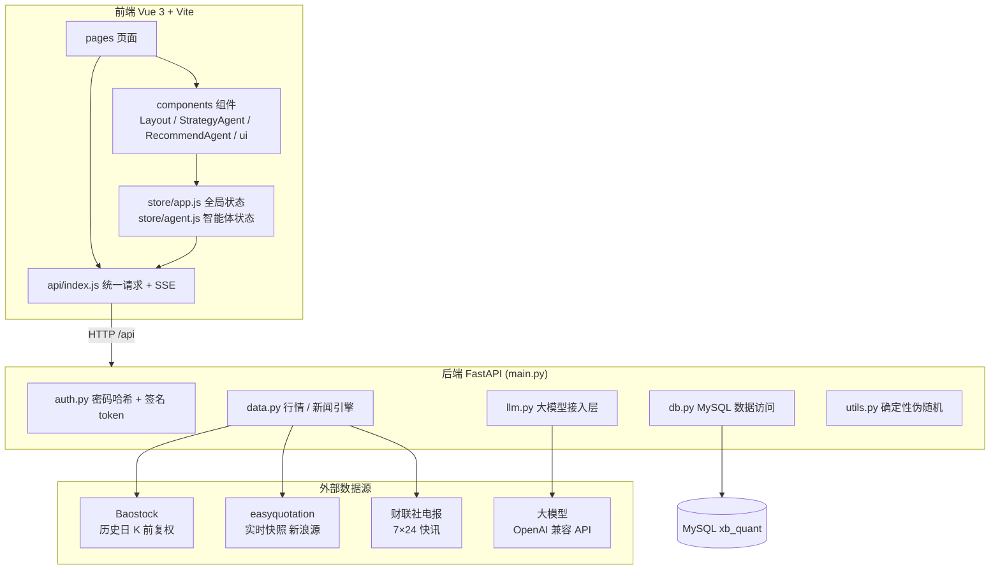
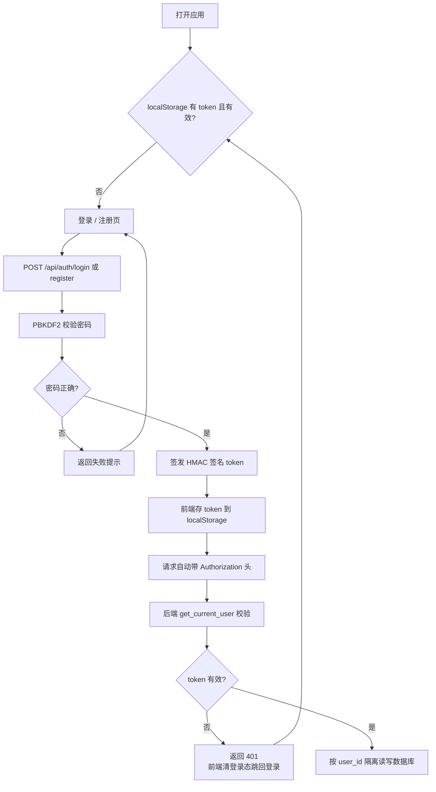
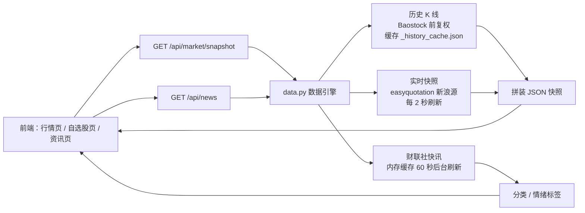
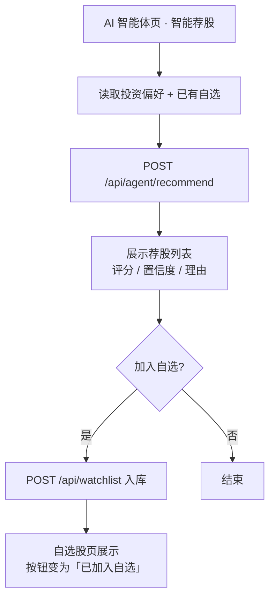
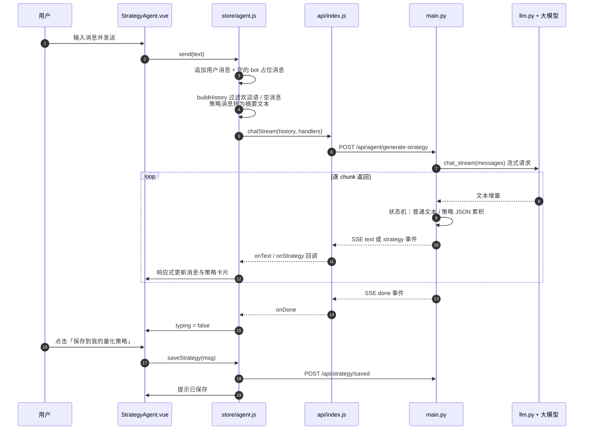
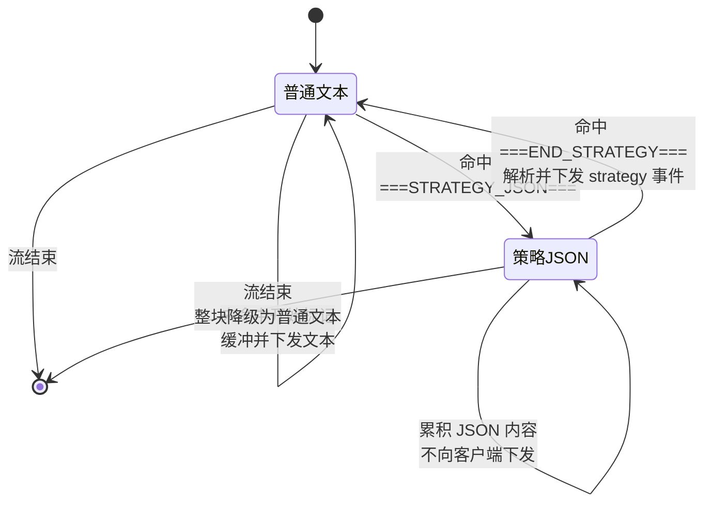
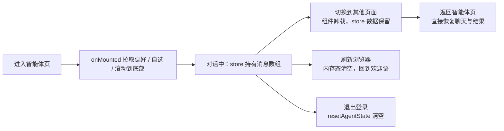
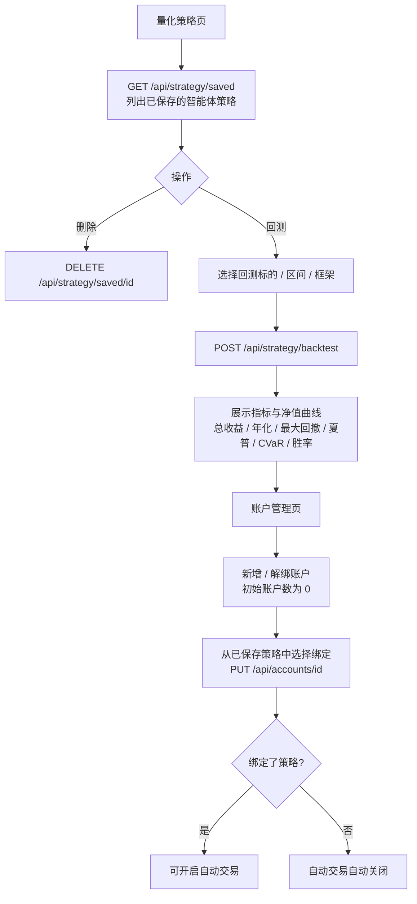

# QuantAI 智能量化投资系统

一个前后端分离的量化投资平台，内置真实行情引擎、策略回测、AI 智能体与账户资产管理，适合量化入门学习、策略研究与教学演示。行情与新闻接入真实免费源（历史 K 线用 Baostock 前复权、实时快照用 easyquotation、财经快讯用财联社电报），量化策略由大模型根据自然语言描述生成。

## 功能特性

- **真实行情引擎**：24 只 A 股 + 4 大指数，实时秒级推送；历史 K 线（前复权）与实时快照分别来自 Baostock / easyquotation，二者严格分离
- **AI 策略生成**：用自然语言描述投资想法，大模型流式返回对话内容与结构化策略，可一键保存到「我的量化策略」
- **AI 智能荐股**：按投资偏好筛选标的，输出评分、置信度与理由，可一键加入自选股
- **策略回测**：内置双均线、MACD、布林带、RSI、动量突破 5 种回测引擎，选择标的 / 区间 / 框架即可回测
- **回测指标**：总收益、年化收益、最大回撤、夏普比率、CVaR、胜率、盈亏比等
- **账户管理**：模拟盘 / 实盘账户独立管理，支持新增、解绑、绑定已保存策略与自动交易开关
- **财经资讯**：财联社 7×24 小时快讯，分类浏览、关键词检索、情绪标签
- **投资偏好**：风险等级、持仓周期、行业板块、止损止盈与交易提醒设置

## 技术栈

| 端 | 技术 |
| --- | --- |
| 前端 | Vue 3 · Vite · Vue Router · ECharts |
| 后端 | Python · FastAPI · Uvicorn · PyMySQL |
| 数据库 | MySQL 5.7+ |
| 大模型 | OpenAI 兼容 API（默认小米 MiMo，可切换任意兼容模型） |

## 目录结构

```
myProject/
├── quant-invest-server-py/       # Python 后端（FastAPI）
│   ├── main.py                   # 路由、鉴权、指标计算、回测、智能体 SSE 接口
│   ├── data.py                   # 行情 / 新闻数据引擎与静态配置
│   ├── db.py                     # MySQL 数据访问层
│   ├── auth.py                   # PBKDF2 密码哈希与 HMAC 签名 token
│   ├── llm.py                    # 大模型接入层（流式调用 + 系统提示词）
│   ├── llm_config.py             # 大模型 API 配置（已 gitignore，需自行创建）
│   ├── db_config.py              # 数据库连接配置（已 gitignore，需自行创建）
│   ├── utils.py                  # 确定性伪随机工具
│   └── requirements.txt          # 后端依赖
├── quant-invest-vue/             # 前端（Vue 3 + Vite）
│   ├── src/
│   │   ├── api/index.js          # 统一请求封装 + SSE 流式解析
│   │   ├── components/           # Layout、智能体组件、通用 ui 组件
│   │   ├── lib/                  # constants.js 静态选项、utils.js 格式化
│   │   ├── pages/                # 各业务页面
│   │   ├── router/index.js       # 路由与登录守卫
│   │   ├── store/                # app.js 全局状态、agent.js 智能体状态
│   │   └── styles/global.css
│   ├── index.html
│   └── package.json
├── database_schema.sql           # 数据库建库建表脚本
├── 一键启动量化系统.bat          # 一键启动前后端（Windows）
└── 停止量化系统.bat              # 停止前后端服务
```

## 快速开始

### 环境要求

- Python 3.8+
- Node.js 18+
- MySQL 5.7+

### 1. 初始化数据库

在项目根目录执行建库建表脚本（默认库名 `xb_quant`）：

```bash
mysql -u root -p --default-character-set=utf8mb4 < database_schema.sql
```

然后在 `quant-invest-server-py/db_config.py` 中填写连接信息（默认 `127.0.0.1:3306`，用户 `root`）。

### 2. 配置大模型

在 `quant-invest-server-py/llm_config.py` 中填写 OpenAI 兼容接口的配置：

```python
# -*- coding: utf-8 -*-
API_BASE_URL = 'https://your-endpoint/v1'   # 需以 /v1 结尾
API_KEY = 'your-api-key'
MODEL_NAME = 'mimo-v2.6-pro'
```

> 可切换为任意 OpenAI 兼容服务（含本地 Ollama，`API_BASE_URL` 填 `http://localhost:11434/v1` 即可）。模型越小对长系统提示词的指令遵循越弱，建议使用 7B 以上模型以保证策略 JSON 的格式正确率。

### 3. 启动后端（端口 3000）

```bash
cd quant-invest-server-py
pip install -r requirements.txt
python main.py
```

### 4. 启动前端（端口 5189）

```bash
cd quant-invest-vue
npm install
npm run dev
```

### 5. 访问

浏览器打开 http://localhost:5189

> Windows 下也可直接双击 `一键启动量化系统.bat` 自动完成上述步骤并打开浏览器；双击 `停止量化系统.bat` 可关闭服务。

## 页面导航

- 登录 / 注册
- 市场行情：个股与指数快照、K 线、Sparkline 迷你走势，个股可一键加自选
- 自选股：关注的个股实时行情与移除
- 财经资讯：分类浏览与关键词搜索
- AI 智能体：智能荐股、策略生成（流式对话）
- 量化策略：已保存的智能体策略列表、删除、选择回测标的 / 区间 / 框架并查看回测结果
- 账户管理：账户列表、新增 / 解绑账户、绑定已保存策略、自动交易开关
- 投资偏好：风险偏好、持仓约束与交易提醒

## 系统流程

> 以下流程图使用 Mermaid 语法编写，可在 GitHub、Typora、VS Code（安装 Mermaid 插件）等支持 Mermaid 的 Markdown 查看器中直接渲染。

### 1. 系统整体架构



### 2. 登录鉴权流程



### 3. 行情与新闻数据流



> 历史 K 线只保留到最近一个已收盘交易日，今日行情交给实时源，二者严格分离，避免盘中实时价污染回测口径。

### 4. AI 智能体：智能荐股流程



### 5. AI 智能体：策略生成流式流程



#### 5.1 后端流式状态机

模型可能在一次回复里混合「闲聊文字」与「策略 JSON」，后端用 `===STRATEGY_JSON===` / `===END_STRATEGY===` 两个标记把两者切开：



解析策略时先按标准 JSON 解析（`strict=False`，容忍字符串内真实换行），失败再按字段正则兜底提取，保证小模型输出的畸形 JSON 也能落成可保存的策略。

#### 5.2 智能体状态生命周期

聊天记录、荐股结果提升到模块级 store，路由切换不丢失：



### 6. 量化策略回测与账户绑定



> 策略的新增入口只在智能体页（生成后点「保存到我的量化策略」），量化策略页仅支持删除与回测；账户只能绑定已保存的策略。

## API 概览

| 方法 | 路径 | 说明 |
| --- | --- | --- |
| POST | `/api/auth/login` | 登录 |
| POST | `/api/auth/register` | 注册 |
| GET | `/api/market/snapshot` | 行情快照（含全部标的与历史 K 线） |
| GET | `/api/news` | 新闻列表（财联社实时快讯，支持分类 / 关键字） |
| GET | `/api/news/categories` | 新闻分类 |
| GET/POST | `/api/prefs` | 获取 / 保存投资偏好 |
| POST | `/api/agent/recommend` | 智能荐股 |
| POST | `/api/agent/generate-strategy` | 策略生成智能体（SSE 流式） |
| GET | `/api/strategy/frameworks` | 回测框架列表 |
| POST | `/api/strategy/backtest` | 执行回测 |
| GET/POST | `/api/strategy/saved` | 已保存策略列表 / 保存策略 |
| DELETE | `/api/strategy/saved/{id}` | 删除已保存策略 |
| GET/POST | `/api/watchlist` | 自选股列表 / 加入自选 |
| DELETE | `/api/watchlist/{code}` | 移除自选 |
| GET/POST | `/api/accounts` | 账户列表 / 新增账户 |
| PUT | `/api/accounts/{id}` | 更新账户 |
| DELETE | `/api/accounts/{id}` | 解绑账户 |
| GET | `/api/health` | 健康检查 |

### 策略生成接口的流式协议

`POST /api/agent/generate-strategy` 请求体为 `{ messages: [{role, content}, ...] }`，响应为 `text/event-stream`，每行一个事件：

```
data: {"type":"text","data":"增量文本"}
data: {"type":"strategy","data":{ "name": ..., "engineId": ..., "params": {...}, "rules": [...], "code": "..." }}
data: {"type":"done","data":{}}
```

后端用 `===STRATEGY_JSON===` / `===END_STRATEGY===` 标记切分闲聊文本与策略 JSON；策略块不会以原始文本下发，解析成功才推送 `strategy` 事件。解析采用「标准 JSON（`strict=False`，容忍字符串内换行）→ 字段正则兜底」两级策略，兼容小模型输出的畸形 JSON。

## 依赖清单

### 后端（Python · requirements.txt）

| 包 | 版本 | 用途 |
| --- | --- | --- |
| fastapi | >=0.100 | Web 框架，提供 REST API |
| uvicorn | >=0.23 | ASGI 服务器，运行 FastAPI |
| easyquotation | >=0.7.7 | 实时行情（新浪源） |
| baostock | >=0.8.8 | 历史行情（前复权日 K） |
| requests | >=2.25 | HTTP 请求（财联社新闻、大模型流式调用） |
| pymysql | >=1.1 | MySQL 数据库驱动 |

### 前端（npm · package.json）

| 包 | 版本 | 用途 |
| --- | --- | --- |
| vue | ^3.4.38 | 前端框架 |
| vue-router | ^4.4.3 | 前端路由 |
| echarts | ^5.5.1 | 图表（K 线、净值曲线等） |
| vite | ^5.4.8 | 构建工具 / 开发服务器（devDependency） |
| @vitejs/plugin-vue | ^5.1.3 | Vue 单文件组件编译（devDependency） |

## 说明

- 行情（历史 K 线、实时快照）与财经新闻（财联社快讯）接入真实免费源，数据源失效时前端展示「系统繁忙，请稍后重试」等提示，不会降级为模拟数据；账户、偏好、自选股、已保存策略等用户数据持久化存储于 MySQL，按 `user_id` 隔离。本平台仅供学习演示，不构成任何投资建议。
- 首次启动会联网拉取历史行情并缓存到本地 `_history_cache.json`，之后启动直接读缓存，无需重新联网。
- 智能体对话记录保存在前端内存 store 中：切换页面不会丢失，刷新浏览器会重置，退出登录自动清空。
- `db_config.py`（数据库密码）与 `llm_config.py`（大模型 API Key）含敏感信息，已加入 `.gitignore`，请勿提交到版本库。
- 后端默认监听 `127.0.0.1:3000`，前端通过环境变量 `VITE_API_BASE` 可覆盖其 API 地址（默认 `http://localhost:3000/api`）。
- 股市有风险，投资需谨慎！
