# Iktsuarpok 智能量化投资系统

一个前后端分离的量化投资平台，内置真实行情引擎、策略回测、AI 智能体与账户资产管理，适合量化入门学习、策略研究与教学演示。行情与新闻接入真实免费源（历史 K 线用 Baostock 前复权、实时快照用 easyquotation、财经快讯用财联社电报），量化策略由大模型根据自然语言描述生成。

## 功能特性

- **真实行情引擎**：200 只 A 股（覆盖 17 个板块）+ 4 大指数，实时秒级推送；历史 K 线（前复权）与实时快照分别来自 Baostock / easyquotation，二者严格分离
- **AI 策略生成智能体（Quant Buffett）**：先做规则优先的意图识别（高置信关键词命中即跳过模型，模糊输入才交大模型判定），再分四路执行：闲聊直连大模型；量化 / 投资知识问答先检索本地知识库再据参考资料作答；查行情 / 走势 / 基本面 / 财经新闻、加删自选股等走 ReAct 工具循环（思考→调用→观察，最多 6 步）；描述投资想法则进入 R&D-Agent 式「假设→回测→反馈」迭代研究循环（最多 3 轮，ε-贪心多臂老虎机选引擎，按奖励收敛），产出可一键保存的结构化策略；内置工具含个股行情查询、自选股增删（重复添加会提示「股票已在自选股中」）、东方财富基本面、技术走势分析、财经新闻查询、RAG 检索；回答以 SSE 流式逐 token 推送，每条附「思考过程」面板展示意图判定与逐步 trace
- **自由构建（Strategy Builder）**：拖拽式画布搭建策略——数据源 / 技术指标 / 条件判断 / 逻辑组合 / 交易动作五类节点连线成图，端口分数值序列与布尔信号、同类才能相连；保存前实时校验（缺连线 / 类型不匹配 / 成环 / 缺买卖信号等），通过后生成规则文本与伪代码预览，内置双均线 / MACD 零轴上金叉 / RSI 超卖反转三套模板，支持编辑已保存策略并一键回测；图以纯数据 DSL 存入 `saved_strategies`（`engine_id='builder'`），后端白名单求值、不执行任何用户代码
- **AI 智能荐股（Recommend Buffett）**：从已保存的偏好中选一套，按关注板块筛选标的，输出评分、置信度与理由，可一键加入自选股
- **向量知识库（RAG）**：独立后台管理页上传文档，经递归分块与本地 Ollama `qwen3-embedding` 向量化后写入本地 Chroma；策略生成时走模块化检索管线（查询改写 → 多路检索 → RRF 融合 → 重排序 → 上下文压缩）召回 Top-K 片段拼入提示词；可开启本地大模型 Self-RAG 分析（判定是否检索、内容是否有用）
- **知识库管理后台**：左侧功能导航（用户管理 / 上传文档 / 检索测试）+ 右侧面板，支持文档上传 / 列表 / 删除、知识库统计与检索测试
- **后台模块设置**：可插拔模块化 RAG 检索管线——按需开启 / 关闭「查询改写 / 多路融合 / 重排序 / 上下文压缩 / 本地大模型分析（Self-RAG）」各模块，并调整融合方式、改写方式、召回条数与相似度下限，保存后策略生成即时生效
- **效果测评（LlamaIndex）**：后台一键测评当前 RAG 配置，评测集由 LlamaIndex `RagDatasetGenerator` 从知识库自动合成（问题 + 标准答案 + 来源片段，按指纹缓存复用），输出上下文精确率 / 上下文召回率 / 忠实度 / 答案相关性 / 答案正确率五项指标与逐题明细；并以蛛网图 + 柱状图对比「优化前基线 / 行业标准 / 一键测评」三组分数
- **后台用户管理**：查看全部用户（含管理员），新增 / 编辑 / 删除账号；权限变更（是否管理员）与删除管理员账号仅超级管理员可操作，普通管理员只能删除普通用户，且变更即时生效（每次请求回库复核）
- **策略回测**：内置双均线、MACD、布林带、RSI、动量突破 5 种回测引擎，自由构建策略也走同一套模拟交易与绩效计算，选择标的 / 区间 / 框架即可回测
- **回测指标**：总收益、年化收益、最大回撤、夏普比率、CVaR、胜率、盈亏比等
- **账户管理**：模拟盘 / 实盘账户独立管理；登录凭证与账户本体分离、Fernet 加密存储，连接器层按账户类型路由（模拟盘固定 100 万、实盘经平台适配器拉取），连接测试成功后自动读取账户资金回填
- **量化交易**：交易任务卡片管理——每张卡片配置标的 / 策略 / 账户（Chip 标签展示、三列对齐，标的超 3 个可点开查看全部）；点「修改」弹窗编辑、保存后生效，三要素齐备才能开启自动交易
- **财经资讯**：财联社 7×24 小时快讯，分类浏览、关键词检索、情绪标签
- **投资偏好**：可保存多套偏好并自定义名称、设为默认，供荐股使用；列表式管理，新增 / 编辑通过弹窗完成
- **交易提醒**：独立开关，存于 `user_settings`，在量化交易页调整

## 技术栈

| 端 | 技术 |
| --- | --- |
| 前端 | Vue 3 · Vite · Vue Router · ECharts · Vue Flow（自由构建画布） |
| 后端 | Python · FastAPI · Uvicorn · PyMySQL |
| 数据库 | MySQL 5.7+ |
| 大模型 | OpenAI 兼容 API（默认本地 Ollama `qwen3:0.6b`，经 `.env` 可切换任意云端 / 本地兼容模型）|
| 向量知识库 | Chroma（本地持久化）· 本地 Ollama `qwen3-embedding:0.6b` 向量化（1024 维） |
| 效果测评 | LlamaIndex（评测集合成 + Retriever / Faithfulness / Relevancy / Correctness 评估器） |
| 部署 | Docker · Docker Compose（可选，见「Docker 部署」章节） |

## 目录结构

```
Iktsuarpok/
├── quant-invest-server-py/       # Python 后端（FastAPI）
│   ├── main.py                   # 应用入口：装配路由、启动行情 / 新闻引擎、超级管理员播种、全局异常处理
│   ├── routers/                  # 按业务拆分的 APIRouter 包（auth / market / prefs / agent / admin / kb / strategy / watchlist / accounts / tasks）
│   ├── common.py                 # 跨路由共享工具：统一错误响应、JSON 列读取、用户 / 管理员鉴权依赖
│   ├── data.py                   # 行情 / 新闻数据引擎与静态配置（个股池 200 支，覆盖 17 个板块）
│   ├── db.py                     # MySQL 数据访问层
│   ├── auth.py                   # PBKDF2 密码哈希与 HMAC 签名 token（用户 / 管理员双 scope）
│   ├── admin_config.py           # 超级管理员账号（仅首次启动播种，全局唯一、不可删除）
│   ├── credentials.py            # 账户登录凭证 Fernet 加密存取（account_credentials 表）
│   ├── connectors.py             # 账户连接器层：按账户类型路由，连接测试与资金读取（模拟盘 / 通用 HTTP）
│   ├── backtest.py               # 回测引擎：内置五策略信号 + 自由构建图信号，共用模拟交易与绩效计算
│   ├── indicators.py             # 共享技术指标：SMA / EMA / RSI（回测与自由构建复用）
│   ├── builder_engine.py         # 自由构建引擎：图 DSL 校验 → 拓扑求值编译买卖信号 → 规则文本 / 伪代码生成
│   ├── rag.py                    # 本地向量知识库：文本抽取 → 递归分块 → 向量化 → Chroma
│   ├── modular_rag.py            # 模块化 RAG：查询改写 → 多路检索（向量 + BM25）→ RRF 融合 → 重排序 → 上下文压缩
│   ├── rag_eval.py               # LlamaIndex 效果测评：评测集合成（缓存）+ 五项指标评估
│   ├── llm.py                    # 大模型接入层（非流式 chat + 流式 chat_stream；qwen3 系列自动关闭深度思考）
│   ├── prompts.py                # 全部提示词集中管理（人格 / 意图 / 闲聊 / 知识 / 研究 / 荐股 + RAG 构建器，零依赖）
│   ├── agent_core.py             # 智能体编排：规则优先意图识别 → 闲聊直连 / ReAct 工具循环 / 迭代研究循环（SSE 流式 + trace）
│   ├── agent_tools.py            # 智能体工具层：行情查询 / 自选增删 / 东方财富基本面 / 走势分析 / RAG 检索
│   ├── llm_config.py             # 大模型 / 向量化模型配置（已脱敏可提交，从环境变量 / .env 读取密钥）
│   ├── db_config.py              # 数据库连接配置（已 gitignore，需自行创建）
│   ├── kb_store/                 # Chroma 向量库本地持久化目录（运行时自动生成，已 gitignore）
│   ├── utils.py                  # 确定性伪随机工具
│   ├── requirements.txt          # 后端依赖
│   ├── Dockerfile                # 后端镜像：python:3.10-slim + 依赖，由入口脚本启动
│   ├── docker-entrypoint.sh      # 容器入口：按环境变量生成配置，以 0.0.0.0 启动 uvicorn
│   └── .dockerignore             # 后端构建上下文忽略：.venv / 配置 / 运行时缓存
├── quant-invest-vue/             # 前端（Vue 3 + Vite）
│   ├── src/
│   │   ├── api/index.js          # 统一请求封装 + 用户 / 管理员双 token
│   │   ├── components/           # Layout、智能体组件、通用 ui 组件、builder 画布节点、admin 后台面板（用户 / 文档 / 检索 / 模块设置 / 效果测评）
│   │   ├── lib/                  # constants.js 静态选项、utils.js 格式化、builderSchema.js 自由构建图 DSL 前端定义与模板
│   │   ├── pages/                # 各业务页面（含 StrategyBuilder.vue 自由构建、Admin.vue / AdminLogin.vue 后台）
│   │   ├── router/index.js       # 路由与登录守卫（前台 / 后台两套独立登录态）
│   │   ├── store/                # app.js 全局状态、agent.js 智能体状态
│   │   └── styles/global.css
│   ├── index.html
│   ├── package.json
│   ├── Dockerfile                # 前端镜像：node:22-alpine 构建 → nginx:alpine 托管
│   ├── nginx.conf                # 静态资源与 SPA 回退 + /api 反向代理到后端
│   └── .dockerignore             # 前端构建上下文忽略：node_modules / dist
├── .venv/                        # Python 虚拟环境（后端依赖安装于此，已 gitignore）
├── docker-compose.yml            # Docker 编排：mysql + backend + frontend 三服务
├── .env                          # 密钥 / 模型 / 端口配置（本地开发与 Docker 共用，已 gitignore）
├── .env.example                  # .env 模板（可提交，占位值不含真实密钥）
├── database_schema.sql           # 数据库建库建表脚本
├── 一键启动量化系统.bat          # 一键启动前后端（Windows）
└── 停止量化系统.bat              # 停止前后端服务
```

## 快速开始

### 环境要求

- Python 3.10+（推荐 3.10 / 3.11；3.13 部分依赖可能尚无预编译 wheel）
- Node.js 18+
- MySQL 5.7+
- Ollama（可选，用于本地对话模型与向量化模型；不装也可改配任意 OpenAI 兼容的云端服务）
- Docker 20.10+ 与 Docker Compose v2（可选，见「Docker 部署」；用容器运行则本机无需装 Python / Node / MySQL）

### 1. 创建虚拟环境并安装后端依赖

后端依赖统一装在项目根目录的 `.venv/` 中，与系统全局 Python 隔离（该目录已加入 `.gitignore`）。

```bash
# 在项目根目录执行
python -m venv .venv          # 创建虚拟环境

# Windows 激活
.venv\Scripts\activate
# macOS / Linux 激活
source .venv/bin/activate

# 激活后安装依赖（激活成功时命令行提示符前会出现 (.venv)）
pip install --upgrade pip
pip install -r quant-invest-server-py/requirements.txt
```

> 也可以不激活，直接用虚拟环境内的解释器绝对路径执行：`.venv\Scripts\python.exe`（Windows）或 `.venv/bin/python`（macOS / Linux）。
> 创建时若 `python` 指向了 IDE 自带的解释器，请改用完整路径，例如 `D:\python\python.exe -m venv .venv`。

### 2. 初始化数据库

在项目根目录执行建库建表脚本（默认库名 `xb_quant`）：

```bash
mysql -u root -p --default-character-set=utf8mb4 < database_schema.sql
```

然后在 `quant-invest-server-py/db_config.py` 中填写连接信息（默认 `127.0.0.1:3306`，用户 `root`）。

### 3. 配置大模型与向量化模型

密钥与模型地址统一放在项目根目录的 `.env`（已 gitignore，参考可提交的 `.env.example`）。`quant-invest-server-py/llm_config.py` 已脱敏、可提交，启动时自动读取环境变量 / `.env`，无需改代码。对话模型与向量化模型相互独立：

```bash
# .env（复制 .env.example 后填写真实值；不要提交到版本库）
# ====== 对话模型（智能体 / 智能荐股） ======
LLM_API_BASE_URL=https://your-endpoint/v1   # 本地 Ollama 填 http://localhost:11434/v1
LLM_API_KEY=sk-your-key                     # Ollama 不校验 Key，填任意非空值或留空
LLM_MODEL_NAME=qwen3:0.6b

# ====== 向量化模型（RAG 知识库专用） ======
EMBED_BASE_URL=http://localhost:11434/v1
EMBED_API_KEY=ollama
EMBED_MODEL=qwen3-embedding:0.6b
```

> 不创建 `.env` 时回落到本地 Ollama 默认值（`qwen3:0.6b` + `qwen3-embedding:0.6b`），开箱即用。可切换为任意 OpenAI 兼容服务。模型越小对长系统提示词的指令遵循越弱，智能体的意图识别 / ReAct / 研究循环建议使用 7B 以上模型以保证 JSON 格式正确率。
> **qwen3 系列自动关闭深度思考**：当 `LLM_MODEL_NAME` 含 `qwen3` 时，`llm.py` 会在每次请求体顶层附加 `enable_thinking: false`（DashScope / 百炼兼容模式约定），跳过默认开启的思考链以加快响应；非 qwen3 模型不受影响，无需手动配置。
> 向量化模型同理，任何兼容 `/embeddings` 接口的服务都可替换 `EMBED_BASE_URL` / `EMBED_MODEL`，例如阿里云百炼的 `text-embedding-v3`（同样 1024 维）；换模型后建议清空 `kb_store/` 重新建立索引，避免不同模型的向量混用。
> Docker 部署复用同一组环境变量（见「Docker 部署」），compose 会把它们注入后端容器，`llm_config.py` 在容器内同样按环境变量生效。

#### 本地向量模型准备（Ollama）

```bash
ollama pull qwen3-embedding:0.6b   # 约 0.6GB，输出 1024 维向量
ollama list                        # 确认模型已就绪
```

> 验证接口可用：`curl http://localhost:11434/v1/embeddings -d '{"model":"qwen3-embedding:0.6b","input":"测试"}'`，返回 1024 个浮点数即正常。
> 该项目也支持批量的 `/v1/embeddings`（`input` 传数组），后台一次请求编码 10 个分块。

### 4. 启动后端（端口 3000）

```bash
cd quant-invest-server-py
python main.py
```

> 依赖已在第 1 步装进 `.venv`，此处无需再执行 `pip install`。若未激活虚拟环境，请用绝对路径启动：`..\.venv\Scripts\python.exe main.py`。
> 不要使用系统全局的 `python`：若 PATH 中存在 IDE 自带的解释器，它通常没有安装 fastapi，会直接报 `ModuleNotFoundError`。

### 5. 启动前端（端口 5189）

```bash
cd quant-invest-vue
npm install
npm run dev
```

### 6. 访问

浏览器打开 http://localhost:5189

> Windows 下也可直接双击 `一键启动量化系统.bat` 自动完成上述步骤并打开浏览器；双击 `停止量化系统.bat` 可关闭服务。

## Docker 部署

不想在本机装 Python / Node / MySQL 时，可用 Docker 一条命令拉起整套系统：MySQL、FastAPI 后端、Nginx 前端三个容器由 `docker-compose.yml` 统一编排。

### 前置条件

- 安装 Docker Desktop（Windows / macOS）或 Docker Engine + Compose v2（Linux）
- 本机已安装并启动 Ollama（对话模型与向量化模型跑在宿主机上，容器通过 `host.docker.internal` 访问）

### 启动

```bash
# 在项目根目录执行
docker compose up -d --build     # 构建并启动三个容器（首次需下载依赖，耗时较长）
docker compose ps                # 查看容器状态
docker compose logs -f backend   # 查看后端日志
docker compose restart backend   # 只重启后端
docker compose down              # 停止并删除容器（数据卷保留）
docker compose down -v           # 连同 MySQL 数据与向量知识库一起清空（慎用）
```

启动完成后访问 http://localhost:5189 ，后台管理入口 http://localhost:5189/admin/login （默认 `admin` / `123456`）。

### Docker 相关文件

| 文件 | 作用 |
| --- | --- |
| `docker-compose.yml` | 编排 mysql / backend / frontend 三个服务；对外发布前端 `5189`、MySQL `3307`（避开本机已有的 3306）；backend 不对外发布端口，仅由 Nginx 反向代理访问；声明 `host.docker.internal:host-gateway` 让容器能访问宿主机服务 |
| `quant-invest-server-py/Dockerfile` | 后端镜像：基于 `python:3.10-slim` 安装 `requirements.txt` 依赖，由入口脚本启动 |
| `quant-invest-server-py/docker-entrypoint.sh` | 容器入口脚本：按环境变量生成 `db_config.py`（`llm_config.py` 已随镜像提交、直接读环境变量），再以 `0.0.0.0:3000` 启动 uvicorn |
| `quant-invest-server-py/.dockerignore` | 后端构建上下文忽略：`.venv` / 配置文件 / 运行时缓存 |
| `quant-invest-vue/Dockerfile` | 前端镜像：`node:22-alpine` 构建静态包 → `nginx:alpine` 托管 |
| `quant-invest-vue/nginx.conf` | 静态资源与 SPA 路由回退，并把 `/api` 反向代理到 backend |
| `quant-invest-vue/.dockerignore` | 前端构建上下文忽略：`node_modules` / `dist` |

### 可调参数

在项目根目录新建 `.env` 覆盖 compose 中的默认值（该文件已加入 `.gitignore`）：

| 变量 | 默认值 | 说明 |
| --- | --- | --- |
| `WEB_HOST_PORT` | `5189` | 前端对外端口 |
| `MYSQL_HOST_PORT` | `3307` | MySQL 对外端口（仅需外部工具连库时用到） |
| `MYSQL_ROOT_PASSWORD` | `123456` | MySQL root 密码 |
| `XB_QUANT_SECRET` | `xb-quant-internal-secret` | 登录 token 的 HMAC 签名密钥 |
| `CRED_SECRET_KEY` | 内置默认值 | 账户登录凭证的 Fernet 加密密钥；**务必固定**，否则重启后已存的凭证密文无法解密 |
| `LLM_API_BASE_URL` | `http://host.docker.internal:11434/v1` | 对话模型地址 |
| `LLM_API_KEY` | 空（Ollama 不校验） | 对话模型 API Key；云端服务必填 |
| `LLM_MODEL_NAME` | `qwen3:0.6b` | 对话模型名 |
| `EMBED_BASE_URL` | `http://host.docker.internal:11434/v1` | 向量化模型地址 |
| `EMBED_API_KEY` | `ollama` | 向量化模型 API Key |
| `EMBED_MODEL` | `qwen3-embedding:0.6b` | 向量化模型名 |

### 关键设计

- **同源请求**：前端镜像构建时注入 `VITE_API_BASE=/api`，页面用相对路径请求、由 Nginx 代理到后端，因此换机器、换域名都不用改代码，浏览器侧也不会出现跨域。
- **配置来源**：`db_config.py` 是私人配置（已 gitignore、镜像内不存在），容器每次启动按环境变量重新生成，挂载同名文件到 `/app` 可覆盖；`llm_config.py` 已脱敏随镜像提交，启动时直接读环境变量 / `.env`，本地与容器共用同一组变量名，无需入口脚本生成。
- **模型跑在宿主机**：容器内的 `127.0.0.1` 指容器自身，因此模型地址写 `host.docker.internal`（Docker Desktop 内置该别名并转发到宿主机 loopback，Ollama 只监听 `127.0.0.1:11434` 也能连上）；数据库则写服务名 `mysql`。
- **数据持久化**：MySQL 数据（卷 `mysql-data`）与向量知识库 `kb_store/`（卷 `kb-store`）都在数据卷中，重建容器不丢。

### 注意事项

- `_history_cache.json`（行情历史缓存）、`rag_config.json`（后台模块设置）、`rag_eval_dataset.json`（测评集缓存）落在容器可写层，`docker compose down` 或重新构建后会丢失；如需保留，可先备份：`docker compose cp backend:/app/rag_config.json .`
- 想沿用本机已有的用户 / 策略 / 账户数据，导出后导入容器即可：
  ```bash
  mysqldump -uroot -p xb_quant > xb_quant_dump.sql
  docker compose exec -T mysql mysql -uroot -p123456 xb_quant < xb_quant_dump.sql
  ```
- `database_schema.sql` 挂在 MySQL 容器的 `/docker-entrypoint-initdb.d/`，**仅数据卷为空（首次启动）时执行**；删掉 `mysql-data` 卷重新 `up` 会得到一个全新空库。
- 国内直连 Docker Hub 较慢或拉不动基础镜像时，可在 Docker Desktop → Settings → Docker Engine 里配置镜像加速：`{ "registry-mirrors": ["https://docker.1panel.live", "https://docker.1ms.run"] }`

## 虚拟环境管理

后端使用项目根目录的 `.venv/`，由 Python 标准库 `venv` 创建，不需要额外安装 virtualenv。

| 操作 | Windows | macOS / Linux |
| --- | --- | --- |
| 激活 | `.venv\Scripts\activate` | `source .venv/bin/activate` |
| 退出 | `deactivate` | `deactivate` |
| 不激活直接运行 | `.venv\Scripts\python.exe main.py` | `.venv/bin/python main.py` |

常用维护命令（激活后执行）：

```bash
pip list                        # 查看当前环境已安装的包
pip install -r quant-invest-server-py/requirements.txt   # 按清单补装 / 更新依赖
pip install <包名>              # 新增依赖，记得同步写入 requirements.txt
```

删除重建（环境损坏，或需要更换 Python 版本时）：

```bash
# Windows
rmdir /s /q .venv
python -m venv .venv

# macOS / Linux
rm -rf .venv
python3 -m venv .venv
```

> `.venv/` 已加入 `.gitignore`，不会提交到版本库；换机器后重新执行「快速开始」第 1 步即可，无需拷贝环境目录。
> 切换 Python 大版本（如 3.10 → 3.12）后必须删除 `.venv` 重建，否则 `chromadb` 等含二进制扩展的包会因 ABI 不匹配而导入失败。
> `一键启动量化系统.bat` 会优先使用 `.venv\Scripts\python.exe`，未检测到虚拟环境时回退到系统 `python` 并给出提示。

## 页面导航

- 登录 / 注册
- 市场行情：个股与指数快照、K 线、Sparkline 迷你走势，个股可一键加自选
- 自选股：关注的个股实时行情与移除
- 财经资讯：分类浏览与关键词搜索
- AI 智能体：智能荐股（Recommend Buffett）、策略生成（Quant Buffett）
- 量化策略：已保存策略列表（智能体生成 / 自由构建两类徽标区分）、删除、选择回测标的 / 区间 / 框架并查看回测结果，自由构建策略可点编辑回到画布
- 自由构建（`/strategy/builder`）：拖拽节点画布搭建策略，左侧节点面板 / 中间画布 / 右侧参数与校验结果，载入模板、实时校验、保存与保存并回测，支持编辑已保存策略（`/strategy/builder/:id`）
- 账户管理：账户列表、新增 / 编辑 / 解绑账户，登录凭证加密存储，连接测试成功后自动读取资金
- 量化交易：交易任务卡片（标的 / 策略 / 账户标签化展示、三列对齐）、「修改」弹窗编辑、自动交易开关（标的 + 策略 + 账户齐备才可开启）、交易提醒开关
- 投资偏好：多套偏好的列表管理，新增 / 编辑通过弹窗完成，可设为默认供荐股使用
- 后台管理（`/admin/login`）：左侧功能导航 + 右侧面板，分为用户管理、向量知识库、检索测试、模块设置、效果测评五块；管理员登录后可管理账号与后台权限、上传 / 删除文档、查看知识库统计、做检索测试，可插拔模块化 RAG 管线的各模块与检索参数，并一键运行 LlamaIndex 效果测评

> 后台管理入口与前台的登录态完全独立（各自保存 token）。后台账号即 `users` 表中的普通用户，勾选「后台管理权限」后即可登录后台；超级管理员由后端首次启动时按 `admin_config.py` 播种（默认 `admin / 123456`），全局唯一且不可删除、不可取消管理员身份。

## 系统流程

> 以下流程图使用 Mermaid 语法编写，可在 GitHub、Typora、VS Code（安装 Mermaid 插件）等支持 Mermaid 的 Markdown 查看器中直接渲染。

### 1. 系统整体架构

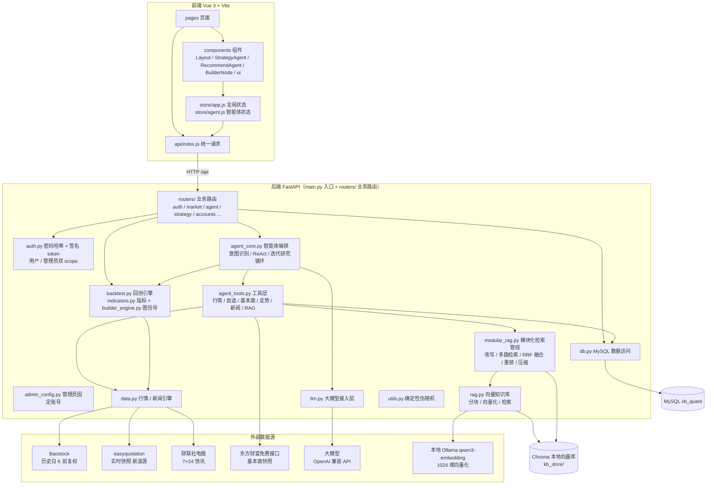

### 2. 登录鉴权流程

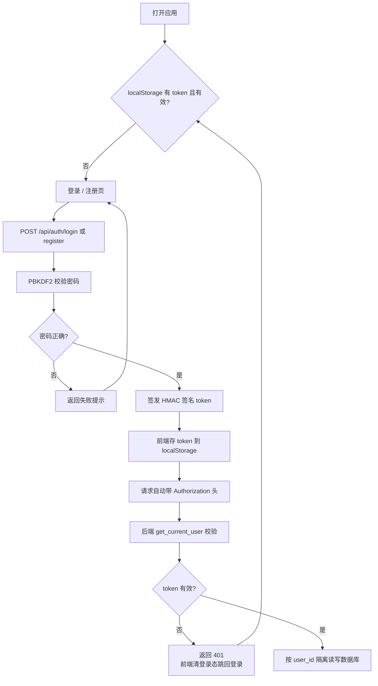

### 3. 行情与新闻数据流

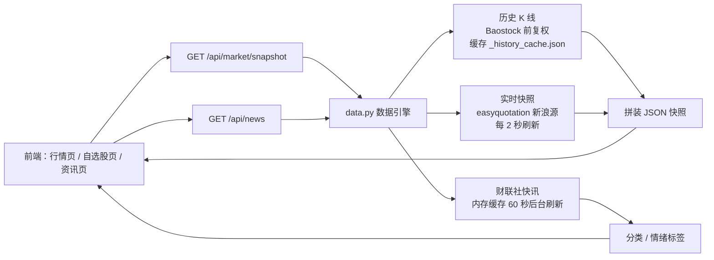

> 历史 K 线只保留到最近一个已收盘交易日，今日行情交给实时源，二者严格分离，避免盘中实时价污染回测口径。

### 4. AI 智能体：智能荐股流程（Recommend Buffett）

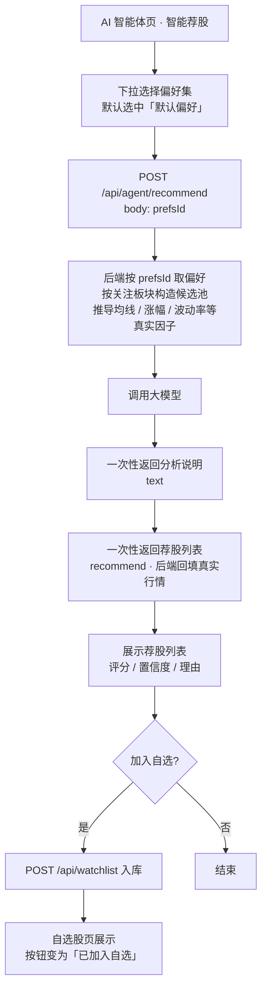

> 候选池之外的代码（模型幻觉）在解析阶段即被丢弃；名称、板块、价格、涨跌幅均由后端按 code 回填真实行情。
> `prefsId` 缺省或该偏好已被删除时，后端回落到默认偏好；用户一套偏好都没有时使用内置默认值（全市场候选池）。

### 4.1 投资偏好：多套偏好管理

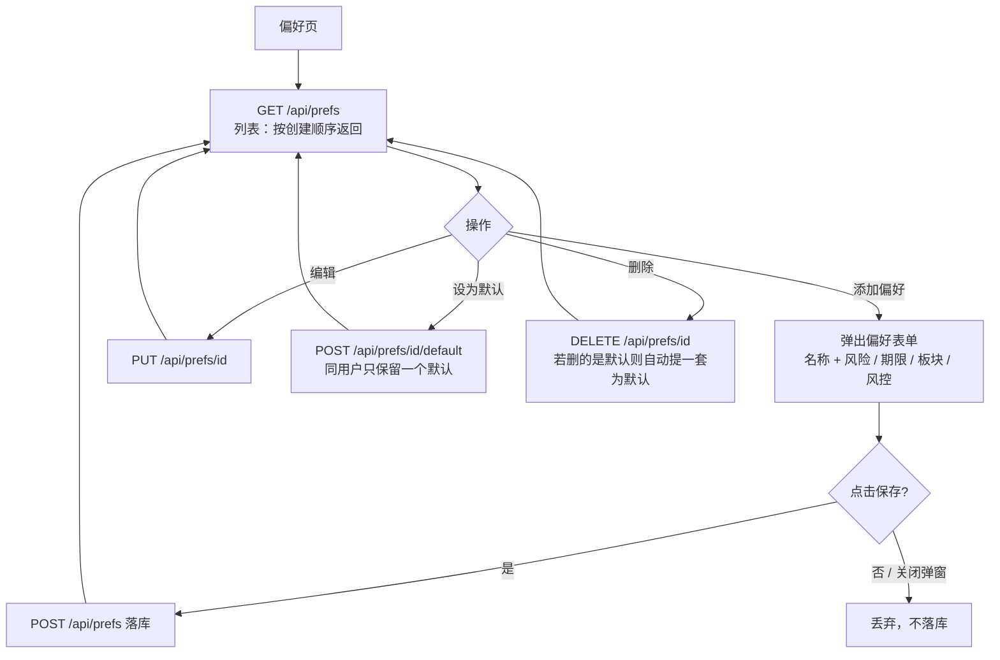

> 偏好名称在同一用户下唯一；用户保存的第一套偏好自动成为默认偏好。
> 交易提醒开关与偏好无关，单独存在 `user_settings`，不参与荐股提示词，可在量化交易页调整。

### 5. AI 智能体：策略生成流程（Quant Buffett）

后端 `agent_core.py` 先做意图识别，再按四路分发执行；`agent_tools.py` 提供白名单工具。编排入口 `run_agent_stream` 以 SSE（Server-Sent Events）流式推送，事件序列为 `intent → trace → rag → text → strategy → done`（异常时 `error`），前端逐事件渲染意图徽标、可展开的「思考过程」面板与文本 / 策略卡片。

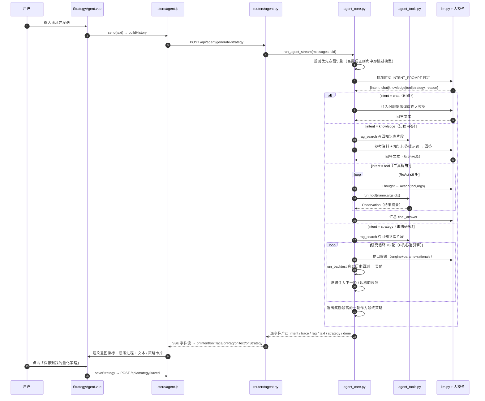

> 知识库为空、未配置向量模型或检索失败时 `rag.count` 为 0 并静默跳过，不影响主流程。RAG 仅作为检索工具被调用，不改变后台「模块设置」里配置好的检索管线。

#### 5.1 意图识别与四路分发

意图识别采用「规则优先」三级策略：`_rule_intent` 先用高置信关键词 / 正则命中直接定档（如明确的买卖 / 回测指令、知识性问句），命中即跳过大模型以提速；模糊输入才交 `INTENT_PROMPT` 让大模型输出 `{intent, reason}`（`chat` / `knowledge` / `tool` / `strategy`）；大模型解析失败或给出非法意图时再回落到 `_fallback_intent` 宽松兜底。四路各自独立：闲聊注入 `CHAT_PROMPT` 直连大模型；知识问答走 `run_knowledge`；工具走 ReAct；策略走迭代研究循环。意图判定理由与后续每一步都会写入 `trace`，供前端「思考过程」面板展示。

量化 / 投资知识性问题（如「什么是夏普比率」「MACD 怎么用」）不算闲聊：`run_knowledge` 先调 `rag_search` 召回本地知识库片段，把片段作为「参考资料」附在 `KNOWLEDGE_PROMPT` 末尾再交给大模型，要求优先依据参考资料作答并用《文档名》标注来源；命中条数计入 `rag.count`（气泡外显示检索图标），未命中时模型结合自身知识补充并说明。

#### 5.2 ReAct 工具循环（intent = tool）

系统提示词列出 `agent_tools.py` 的白名单工具，模型每步输出 `{thought, action:{tool,args}}` 或 `{thought, final_answer}`；后端执行工具并把结果摘要作为 Observation 追加回对话，最多 6 步。工具包括：

| 工具 | 能力 | 数据尺度 |
| --- | --- | --- |
| `query_stock` | 个股实时快照 + 指定日期区间 / 最近 N 天日 K + 区间统计 | 日 OHLCV ≤240 天 + 实时快照 |
| `add_watchlist` / `remove_watchlist` | 自选股增删（数据库操作，按当前登录用户）；重复添加返回「股票已在自选股中」 | MySQL `watchlist` 表 |
| `fundamentals` | 基本面分析（联网） | 东方财富免费接口：PE/PB/市值/ROE/营收利润等 |
| `analyze_trend` | 技术走势分析 | MA5/20/60、RSI14、MACD、20 日波动率、60 日位置、支撑压力 |
| `query_news` | 财经新闻快讯查询，支持关键词 / 分类 / 条数过滤 | 财联社电报内存缓存（含分类与情绪标签） |
| `rag_search` | 仅检索本地知识库 | 复用模块化 RAG 管线，不改配置 |

> 生成策略不作为 ReAct 工具暴露——它是 `strategy` 意图专属的研究循环，避免模型在工具循环里随意拼策略。

#### 5.3 迭代研究循环（intent = strategy，R&D-Agent 式）

先 `rag_search` 召回参考片段，再进入「假设→回测→反馈」循环（最多 3 轮）：每轮用 ε-贪心多臂老虎机（ε=0.3）在内置引擎（双均线 / MACD / RSI / 布林 / 动量）间探索或利用，给出 `engine_hint`；大模型据此提出假设（引擎 + 参数 + 理由），参数经 `_clamp_params` 约束到合法区间后调用 `run_backtest` 在真实历史行情上回测；按 `奖励 = 0.4·年化 + 0.3·夏普/3 + 0.2·(1+最大回撤) + 0.1·胜率` 打分，把上一轮指标作为反馈注入下一轮假设。奖励 ≥0.55 提前收敛，否则跑满 3 轮，取奖励最高的一轮产出结构化策略（`engineId + params`，不执行模型代码）。每轮的引擎 / 参数 / 奖励 / 决策 / 假设 / 指标都记入 `trace`。

#### 5.4 智能体状态生命周期

聊天记录、荐股结果提升到模块级 store，路由切换不丢失：

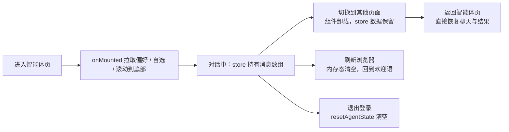

### 6. 向量知识库构建与 RAG 检索

#### 6.1 后台构建知识库（管理员）

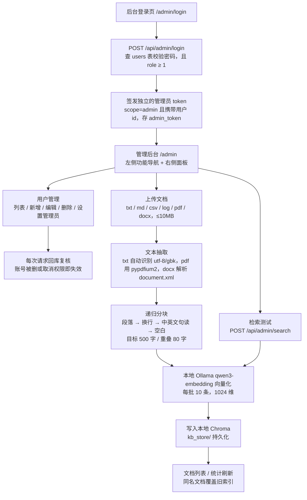

> 文档切块采用递归分块策略：优先按段落切，仍超长则依次降级到换行、中英文句读（`。！？；，、` 等）、空白，全部降级完仍超长才按字符硬切；过短的碎片会与相邻块合并，并给每块加上相邻 80 字重叠，避免语义被切断。

#### 6.2 智能体调用 RAG 检索

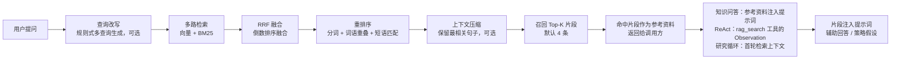

> 检索由 `modular_rag.py` 的模块化管线完成：向量检索复用 Chroma（qwen3-embedding 余弦相似度），BM25 关键词检索基于 jieba + rank_bm25 对全库分块建索引，二者经 RRF 融合后做重排序与（可选的）上下文压缩。各模块由配置开关编排，知识库为空或检索失败时静默跳过、响应中 `rag.count` 为 0，策略生成照常进行。开启「本地大模型分析（Self-RAG）」后，检索前后会各调用一次本地大模型（非流式 `llm.chat`）做判定：判定无需检索时直接返回 0 条、判定检索内容无用时不注入，从而过滤与问题无关的知识库噪声。检索到的片段以「参考资料」形式注入调用方提示词：ReAct 路由下由 `rag_search` 工具按需检索、片段作为 Observation 回灌；策略研究路由下在循环开始前先检索一次、片段作为研究上下文。智能体只调用检索、不修改后台配置好的管线。命中时会在该条回答的气泡外右下角出现一个检索图标（底部与气泡齐平），点击后浮层在图标右侧单行展开「已检索本地知识库，命中 N 条参考片段」，点击空白处或发起新操作会自动收起，未命中则不显示图标。

#### 6.3 效果测评（LlamaIndex）

进入后台「效果测评」后，先用 LlamaIndex `RagDatasetGenerator` 从知识库均匀采样分块合成评测集（问题 + 标准答案 + 来源片段），按知识库指纹缓存到 `rag_eval_dataset.json`，分块集合变化后自动重建；随后每题跑一遍完整模块化管线（检索 + 生成），把检索片段与生成回答交给 LlamaIndex 评估器打分，汇总为五项指标：上下文精确率（RetrieverEvaluator precision）、上下文召回率（recall）、忠实度（FaithfulnessEvaluator）、答案相关性（RelevancyEvaluator）、答案正确率（CorrectnessEvaluator，官方 1-5 分归一到 0-1）。每题独立容错，单题失败不影响其余题目。

### 7. 量化策略回测与量化交易任务

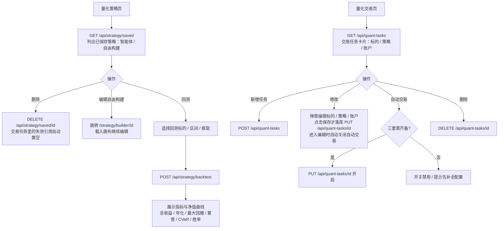

> 策略有两个新增入口：智能体页（自然语言生成后点「保存到我的量化策略」）与自由构建页（拖拽画布搭建后保存）；量化策略页支持删除、回测，自由构建策略还可点编辑回到画布。两类策略共用 `saved_strategies` 表，以 `engine_id` 区分（`builder` 为自由构建，其余为内置引擎），回测时按 `engine_id` 路由到对应信号生成逻辑。
>
> 删除已保存的策略或账户时，交易任务里的对应引用会被置空（`_scrub_task_refs` 把 `strategy_id` / `account_id` 置 NULL）；自动交易开关按「标的 + 策略 + 账户三者齐备」校验，引用缺失即无法开启，避免出现「自动交易开着却没有策略 / 账户」的状态；智能体页历史消息上的「已保存」标记也会在再次进入该页时自动失效，可重新保存。
>
> 账户资金不由用户手填：创建时为 0，连接测试成功后由连接器层自动读取回填（模拟盘固定 1,000,000，实盘经平台适配器拉取）。账户的登录凭证（登录账号 / 密码）与账户本体分离存入 `account_credentials`，密码经 Fernet 加密，接口响应只回显登录账号与 `hasPassword` 标记，永不返回密码。

### 7.1 自由构建画布（Strategy Builder）

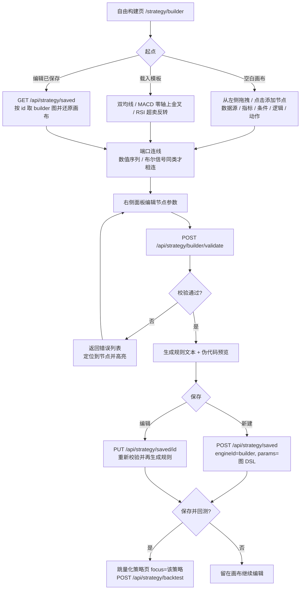

> 图是纯数据 DSL（`{version, nodes, edges}`），节点类型走后端白名单、参数做范围校验，求值只调用内置指标函数（`indicators.py`），不 `eval` 任何用户输入。校验覆盖：缺 id / id 重复、未知类型、参数越界、MACD 快线≥慢线、端口不存在 / 类型不匹配 / 重复连线 / 未连线、缺买入或卖出信号、连线成环。`compile_signals` 先拓扑排序整段算好指标序列，再逐 bar 求值条件，指标预热期（`None`）视为条件不成立、买入优先于卖出，语义与内置引擎对齐（双均线模板回测结果与内置 `ma_cross` 完全一致）。

## API 概览

| 方法 | 路径 | 说明 |
| --- | --- | --- |
| POST | `/api/auth/login` | 登录 |
| POST | `/api/auth/register` | 注册 |
| GET | `/api/market/snapshot` | 行情快照（含全部标的与历史 K 线） |
| GET | `/api/news` | 新闻列表（财联社实时快讯，支持分类 / 关键字） |
| GET | `/api/news/categories` | 新闻分类 |
| GET | `/api/prefs` | 偏好列表（多套，按创建顺序返回） |
| POST | `/api/prefs` | 新增一套偏好（首套自动设为默认） |
| PUT | `/api/prefs/{id}` | 编辑偏好 |
| POST | `/api/prefs/{id}/default` | 设为荐股默认偏好 |
| DELETE | `/api/prefs/{id}` | 删除偏好（删默认时自动补选一套） |
| GET/POST | `/api/settings` | 交易提醒开关（与偏好无关，不参与荐股提示词） |
| POST | `/api/agent/recommend` | 智能荐股（非流式，body 传 `prefsId`） |
| POST | `/api/agent/generate-strategy` | 策略生成智能体（SSE 流式；规则优先意图识别 → 闲聊 / ReAct / 研究循环，逐事件推送 intent / trace / rag / text / strategy） |
| GET | `/api/strategy/frameworks` | 回测框架列表 |
| POST | `/api/strategy/backtest` | 执行回测（内置引擎 / 自由构建图按 `strategyId` 路由） |
| POST | `/api/strategy/builder/validate` | 自由构建画布校验（返回错误列表，通过时附规则文本与伪代码） |
| GET/POST | `/api/strategy/saved` | 已保存策略列表 / 保存策略（`engineId=builder` 时存图 DSL 并再生成规则） |
| PUT | `/api/strategy/saved/{id}` | 编辑已保存策略（名称 / 参数，builder 策略重新校验） |
| DELETE | `/api/strategy/saved/{id}` | 删除已保存策略 |
| GET/POST | `/api/watchlist` | 自选股列表 / 加入自选 |
| DELETE | `/api/watchlist/{code}` | 移除自选 |
| GET/POST | `/api/accounts` | 账户列表 / 新增账户（可带登录凭证，密码加密存储，响应不含密码） |
| PUT | `/api/accounts/{id}` | 更新账户（密码留空表示不修改） |
| POST | `/api/accounts/{id}/test-connection` | 连接测试，成功后自动读取资金并回填 |
| DELETE | `/api/accounts/{id}` | 解绑账户（连带清理交易任务里的失效引用） |
| GET/POST | `/api/quant-tasks` | 交易任务列表 / 新增任务 |
| PUT | `/api/quant-tasks/{id}` | 更新任务（标的 / 策略 / 账户 / 自动交易开关） |
| DELETE | `/api/quant-tasks/{id}` | 删除任务 |
| POST | `/api/admin/login` | 后台管理员登录（查 `users` 表校验，要求 `role` ≥ 1） |
| GET | `/api/admin/users` | 用户列表（含管理员，超级管理员置顶） |
| POST | `/api/admin/users` | 新增用户（`role` 可给 0 普通用户 / 1 管理员；授予权限仅限超级管理员） |
| PUT | `/api/admin/users/{id}` | 编辑用户（用户名 / 手机号 / 密码 / 权限等级；权限变更仅限超级管理员） |
| DELETE | `/api/admin/users/{id}` | 删除用户（连带其偏好 / 策略 / 账户 / 自选股；普通管理员只能删普通用户） |
| GET | `/api/admin/kb/stats` | 知识库统计（文档数 / 分块数 / 向量模型 / 存储位置） |
| GET | `/api/admin/docs` | 已入库文档列表 |
| POST | `/api/admin/docs` | 上传文档（multipart，≤10MB）并建立索引 |
| DELETE | `/api/admin/docs/{id}` | 删除文档及其全部分块 |
| POST | `/api/admin/search` | 检索测试（问题向量化后做相似度比对） |
| GET | `/api/admin/rag-config` | 读取模块化 RAG 配置（模块开关 / 融合与改写方式 / 召回参数） |
| PUT | `/api/admin/rag-config` | 保存模块化 RAG 配置，保存后策略生成检索即时生效 |
| GET | `/api/admin/rag-eval/dataset` | 评测集缓存状态（是否存在 / 题目数 / 裁判模型） |
| POST | `/api/admin/rag-eval` | 效果测评（body：`numQuestions` 1–20 默认 10、`regenerate` 是否重建评测集） |
| GET | `/api/health` | 健康检查 |

> 后台接口统一要求 `Authorization: Bearer <admin_token>`，由 `get_current_admin` 校验；管理员 token 的 scope 为 `admin` 且携带用户 id，与普通用户 token 互不通用，越权访问返回 401。
>
> 用户权限由 `users.role` 单字段表示：`0` 普通用户 / `1` 管理员 / `2` 超级管理员。**权限变更（授予 / 取消管理员）与删除管理员账号仅超级管理员可操作**：普通管理员调用用户管理接口时若携带 `role` 字段会被拒绝（403），删除 `role ≥ 1` 的账号也会被拒绝（403）；前端不会提交 `role` 字段，且权限开关、管理员行的删除按钮呈禁用态。删除用户与设置权限均受保护：超级管理员（`role=2`，全局唯一）不可删除、不可取消管理员身份，且不可通过接口授予；当前登录账号不可删除自己。删除用户时其偏好、策略、账户、自选股由外键 `ON DELETE CASCADE` 一并清理。

### 策略生成接口的响应格式

`POST /api/agent/generate-strategy` 请求体为 `{ messages: [{role, content}, ...] }`（需登录），响应为 **SSE 事件流**（`Content-Type: text/event-stream`），而非一次性 JSON。每个事件按 `event: <名称>\ndata: <JSON>\n\n` 帧格式下发，前端逐事件消费；响应头带 `Cache-Control: no-cache`、`X-Accel-Buffering: no`（关闭 nginx 缓冲，保证逐事件下发）、`Connection: keep-alive`。事件依次为：

| 事件 | data 载荷 | 说明 |
| --- | --- | --- |
| `intent` | `{intent, reason}` | 意图识别结果（`chat` / `knowledge` / `tool` / `strategy`）与判定理由 |
| `trace` | `{trace: [...]}` | 思考过程**累积快照**，前端直接整体替换；每步带 `type`（`intent` / `chat` / `knowledge` / `react` / `research`） |
| `rag` | `{count, sources: [{docName, score}]}` | 检索命中条数与来源，仅命中时非零 |
| `text` | `"增量文本"` | 闲聊 / 知识问答逐 token 推送；工具 / 策略为整段 |
| `strategy` | `{name, type, engineId, params, rules, code}` | 策略卡片，研究循环每刷新最优即推送一次 |
| `done` | `{}` | 流正常结束 |
| `error` | `{message}` | 执行异常时下发，前端展示兜底文案 |

`trace` 数组按路由累积不同步骤：`knowledge` 步记检索命中条数；`react` 步含 `step / thought / tool / args / observation`（末步 `final: true`）；`research` 步含 `round / engine / params / reward / decision / rationale / metrics`。前端把整个 `trace` 渲染成可展开的「思考过程」面板。`rag` 仅在检索命中时非零（知识问答检索、ReAct 的 `rag_search` 或研究循环首轮检索），前端据此在气泡外右下角显示检索图标；知识库为空或不可用时 `count` 为 0，不显示图标。

`strategy` 事件仅 `strategy` 路由产出：研究循环取奖励最高一轮的引擎 + 参数，经参数约束与规则 / 伪代码模板生成结构化策略，其余路由不推送该事件。策略始终为结构化 DSL（`engineId + params`），后端不执行模型生成的任何代码。

### 智能荐股接口的响应格式

`POST /api/agent/recommend` 请求体为 `{ prefsId }` —— 指定使用哪一套已保存偏好；`prefsId` 缺省、或该偏好已被删除时，后端回落到默认偏好，用户一套偏好都没有时使用内置默认值。响应为 JSON：

```json
{
  "text": "分析说明",
  "recommend": [{ "code": "...", "name": "...", "price": "...", "change": "...", "score": "...", "confidence": "...", "action": "...", "reasons": ["..."] }]
}
```

与策略接口不同，荐股流程在调用模型前先用真实行情快照构造候选池（按偏好板块筛选，无匹配时退化为全市场）并推导技术因子（均线、区间位置、涨幅、年化波动率等），把因子表交给模型分析。模型只输出主观字段（`score` / `confidence` / `action` / `reasons`），名称、板块、价格、涨跌幅一律由后端按 `code` 回填真实行情，候选池之外的代码视为幻觉直接丢弃，因此模型无法编造价格或池外标的。JSON 用 `===RECOMMEND_JSON===` / `===END_RECOMMEND===` 包裹，解析失败时整块降级为普通文本落入 `text`。

> 偏好只在服务端按 `prefsId` 读取并校验归属（`user_id` 隔离），前端无法通过伪造请求体越权使用他人偏好。

## 依赖清单

### 后端（Python · requirements.txt）

> 以下依赖安装到项目根目录的 `.venv/` 虚拟环境中，不使用系统全局 Python。

| 包 | 版本 | 用途 |
| --- | --- | --- |
| fastapi | >=0.100 | Web 框架，提供 REST API |
| uvicorn | >=0.23 | ASGI 服务器，运行 FastAPI |
| easyquotation | >=0.7.7 | 实时行情（新浪源） |
| baostock | >=0.8.8 | 历史行情（前复权日 K） |
| requests | >=2.25 | HTTP 请求（财联社新闻、大模型流式 / 非流式调用、向量化接口） |
| pymysql | >=1.1 | MySQL 数据库驱动 |
| chromadb | >=0.4.24 | 本地向量知识库（持久化 + 余弦相似度检索） |
| pypdfium2 | >=4.0 | PDF 文本抽取 |
| python-multipart | >=0.0.6 | FastAPI 解析 multipart 上传 |
| numpy | >=1.24 | 数值计算（模块化 RAG 检索打分 / 排序） |
| jieba | >=0.42 | 中文分词（BM25 关键词检索与重排序） |
| rank_bm25 | >=0.2.2 | BM25 关键词检索（多路检索的稀疏路） |
| llama-index-core | >=0.13,<0.14 | 效果测评（LlamaIndex 评估器 + `RagDatasetGenerator` 评测集合成） |

### 前端（npm · package.json）

| 包 | 版本 | 用途 |
| --- | --- | --- |
| vue | ^3.4.38 | 前端框架 |
| vue-router | ^4.4.3 | 前端路由 |
| echarts | ^5.5.1 | 图表（K 线、净值曲线等） |
| @vue-flow/core | ^1.48.2 | 自由构建拖拽画布（节点 / 连线 / 端口校验） |
| @vue-flow/background | ^1.3.2 | 画布网格背景 |
| @vue-flow/controls | ^1.1.3 | 画布缩放 / 适配控件 |
| vite | ^5.4.8 | 构建工具 / 开发服务器（devDependency） |
| @vitejs/plugin-vue | ^5.1.3 | Vue 单文件组件编译（devDependency） |

## 说明

- 行情（历史 K 线、实时快照）与财经新闻（财联社快讯）接入真实免费源，数据源失效时前端展示「系统繁忙，请稍后重试」等提示；账户、偏好、自选股、已保存策略、量化交易任务等用户数据持久化存储于 MySQL，按 `user_id` 隔离。
- 首次启动会联网拉取历史行情并缓存到本地 `_history_cache.json`，之后启动直接读缓存，无需重新联网。
- 智能体对话记录保存在前端内存 store 中：切换页面不会丢失，刷新浏览器会重置，退出登录自动清空。
- 向量知识库数据保存在后端 `quant-invest-server-py/kb_store/`（Chroma 本地持久化目录），重启服务不丢失，已加入 `.gitignore`；删除该目录即清空知识库，需重新上传文档建立索引。
- 模块化 RAG 的插拔配置由后台「模块设置」保存到 `quant-invest-server-py/rag_config.json`（运行时自动生成，已加入 `.gitignore`）；删除该文件即恢复为代码里的默认配置。
- 效果测评的评测集缓存于 `quant-invest-server-py/rag_eval_dataset.json`（运行时自动生成，已加入 `.gitignore`）；知识库分块集合变化后自动重新合成，删除该文件即强制重建。测评过程需多次调用大模型（合成题目 + 裁判打分），耗时随题目数增长。
- 向量化默认走本地 Ollama（`qwen3-embedding:0.6b`），上传文档与检索时需保证 Ollama 在 `localhost:11434` 运行；Ollama 未启动时后台会提示「向量化服务调用失败」，知识库不可用但策略生成等其它功能不受影响。换用其它向量模型后必须清空 `kb_store/` 重建索引，不同模型的向量不可混用。
- 后台账号复用 `users` 表，权限由单字段 `role` 表示（`0` 普通用户 / `1` 管理员 / `2` 超级管理员）：`role ≥ 1` 即可登录后台，可在「用户管理」中开关授予（仅超级管理员可操作）。超级管理员（`role=2`）全局唯一，由后端首次启动时按 `admin_config.py` 播种（默认 `admin / 123456`），不可删除、不可取消管理员身份。后台登录态与前台的 `quant_token` 完全独立。
- 后台用户管理接口每次请求都会回库复核管理员身份，账号被删除或被取消权限后，其已签发的 token 立即失效（返回 401 并跳回登录页）。
- `db_config.py`（数据库密码）含敏感信息，已加入 `.gitignore`，请勿提交；Docker 部署由容器入口脚本按环境变量生成。大模型 / 向量化模型的密钥与私有地址放根目录 `.env`（已 gitignore，模板见 `.env.example`）；`llm_config.py` 已脱敏、可提交，启动时从环境变量 / `.env` 读取，本地与 Docker 共用同一组变量名。
- 后端默认监听 `127.0.0.1:3000`，前端通过环境变量 `VITE_API_BASE` 可覆盖其 API 地址（默认 `http://localhost:3000/api`）；Docker 镜像在构建时注入 `VITE_API_BASE=/api`，由 Nginx 同源反向代理，无需关心部署地址。
- Docker 部署下，`_history_cache.json`（行情历史缓存）、`rag_config.json`（后台模块设置）、`rag_eval_dataset.json`（测评集缓存）落在容器可写层，`docker compose down` 或重建容器后会丢失；MySQL 数据与 `kb_store/` 向量库分别存放在 `mysql-data`、`kb-store` 数据卷中，不受影响。完整的 Docker 部署说明见上文「Docker 部署」章节。
- 后端依赖统一安装在项目根目录的 `.venv/` 虚拟环境（已 gitignore），与系统全局 Python 隔离；`一键启动量化系统.bat` 优先使用 `.venv\Scripts\python.exe`，未检测到虚拟环境时回退到系统 `python` 并给出提示。
- 本平台仅供学习演示，不构成任何投资建议，股市有风险，投资需谨慎！
